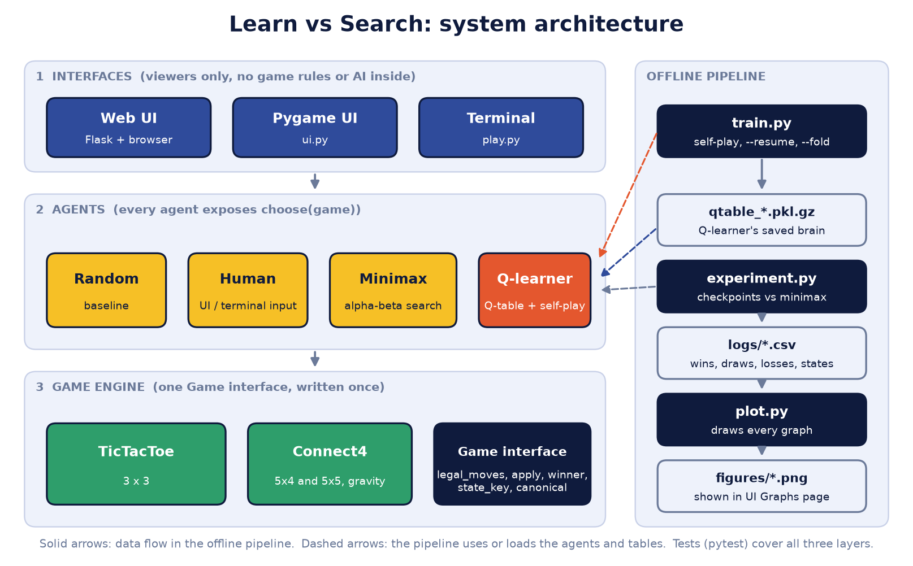

# Learn-Vs-Search

A comparative study of two ways to play Connect-4: an agent that **learns** the game
purely from experience, and an agent that **searches** for the best move by reasoning
ahead. Both are built from scratch in plain Python and pitted against each other on
scaled Connect-4 boards.

- **Learn** — tabular **Q-learning**, trained only through self-play. It starts knowing
  nothing and builds a table of how good each position is by playing millions of games
  against itself.
- **Search** — depth-limited **minimax with alpha-beta pruning**, the classic adversarial
  search algorithm. It never "learns"; it looks a fixed number of moves ahead every time.

## The research question

> **How many self-play games does the Q-learning agent need before it can match
> depth-limited minimax?**

This framing makes the project robust: minimax always works, so even if the learning
agent never catches up, *that* is a complete, measurable result — "the learner needed
more than N games to reach depth-d search, and here is the evidence." An honest mixed or
negative finding scores as well as a win. There is no single point of failure.

## The board ladder

The same game engine runs three boards. Each one proves something the next depends on, so
any bug stays local to the step it appears in rather than hiding several phases back.

| Board | Size | Role |
|-------|------|------|
| **Tic-tac-toe** | 3×3 | Proof-of-life. A *solved* game with known-correct answers: full-depth minimax must never lose, and a trained learner must stop losing. The cheapest place to catch bugs. |
| **Connect-4 (small)** | 5×4 | Validates the real Connect-4 mechanics — gravity, four-in-a-row, diagonal wins, full columns — and trains fast enough that bugs surface in minutes. |
| **Connect-4 (main)** | 5×5 | The headline experiment board. Big enough for rich tactics, still tractable for a table-based method. |

Four-in-a-row throughout. The larger 6×5 and full 7×6 boards are deliberately **avoided** —
their state space is too large for a tabular method and would force a neural-net approach,
which is out of scope.

## How it fits together

Everything hinges on one small idea: **agents never know which board they are playing.**
Every board satisfies a single `Game` interface, so the search and learning code is
written *once* and runs on all three boards unchanged.

```
Game  (what every board provides)                Agent  (what every player provides)
  legal_moves()   -> list of integer moves          choose(game) -> one legal move
  apply(move)     -> a NEW game state
  winner()        -> P1 / P2 / None               Implementations:
  current_player()                                   RandomAgent
  state_key()     -> hashable Q-table key            MinimaxAgent(depth)
  is_terminal() / is_draw()                          QLearningAgent(qtable)
                                                     HumanAgent
```

Two design choices keep the code understandable and bug-resistant:

- **A move is always a plain integer** — a cell index for tic-tac-toe, a column for
  Connect-4 — so no agent ever special-cases a board.
- **Boards are immutable**: `apply(move)` returns a *new* game instead of changing the
  current one. This removes the whole category of "forgot to undo that move" bugs from the
  search and learning loops.

## Project layout

```
games/        board engines — the Game interface (base.py) and each board
agents/       the players: random, minimax, q-learning, human
tests/        hand-checked correctness tests (run with pytest)
train.py      run self-play training; produces a Q-table file
experiment.py train + evaluate against minimax at checkpoints; logs CSV and draws graphs
plot.py       draws every figure from the CSV logs
sweep.py      hyperparameter sweeps (e.g. learning rate)
play.py       play in the terminal (a debugging tool, not a deliverable)
ui.py         a thin Pygame viewer over the finished agents
web/          local browser interface (Flask server + HTML/CSS/JS)
logs/         experiment results (CSV)
figures/      generated graphs (PNG)
screenshots/  screenshots of the web interface
```



The user interfaces (Pygame and web) are only **viewers** — they load a trained table and
call each agent's `choose(game)`. No game rules or AI live in them. Modes: human vs
minimax, human vs Q-learner, and Q-learner vs minimax / random watch modes, with board and
search-depth selectors, a restart button, and a Results page that shows the generated
graphs.

## Results and graphs

### Headline findings

Net score = win% minus loss% against minimax (0 = even match), measured at the end of
training (100,000 games for tic-tac-toe, 500,000 for each Connect-4 board).

| Board | vs depth | Win / Draw / Loss | Net score |
|-------|----------|-------------------|-----------|
| Tic-tac-toe | 9 (perfect) | 0 / 200 / 0 | 0% (best possible: all draws) |
| Tic-tac-toe | 1 and 2 | 181 / 19 / 0 and 92 / 108 / 0 | +90.5% and +46% |
| Connect-4 5×4 | 2 / 4 / 6 | 31/95/74, 27/98/75, 26/90/84 | −21.5% / −24% / −29% |
| Connect-4 5×5 | 2 / 4 | 13/12/75, 5/8/87 | −62% / −82% |

- **Tic-tac-toe** is learned perfectly after roughly 30,000 self-play games; the table
  holds 4,513 of the 4,520 non-terminal positions.
- **5×4** improves steadily (−40.5% to −21.5% against depth 2) but is still behind search,
  and the curves were still rising at 500,000 games.
- **5×5** shows no improvement: the table grows ~6.7× (0.4M to 2.7M states) but covers only
  about 0.0003% of possible configurations, so strength stays flat. Coverage, not memory,
  is the limit of a tabular learner.
- **Alpha-beta** returns the same move as plain minimax with about 97% fewer positions
  searched at depth 7.

### Figures

Drawn by `plot.py` from the logged CSVs (so experiments run once and plots are redrawn as
often as needed). `experiment.py` draws them automatically at the end of a run.

- **Learning curve** — win/draw/loss rate vs. minimax as training progresses; answers the
  research question.
- **Net score** and **outcome mix** — strength and the win/draw/loss shares over training.
- **Depth scaling** — how the finished learner holds up as the searcher looks deeper.
- **Per-seat / first-move advantage** — first-mover vs. second-mover results.
- **Coverage** — table size over training, and strength against table size.
- **Board comparison** — the final result on each board side by side.
- **Alpha-beta efficiency** — positions searched by plain minimax vs. alpha-beta by depth.
- **Hyperparameter sweep** — how the learning rate affects convergence.

Fairness matters on small boards, where going first is a real advantage: evaluation
alternates the starting side exactly 50/50 so the numbers reflect skill, not seating.
(Training is self-play, so one agent already plays both seats.)

## Setup

Requires **Python 3.12**.

```bash
py -3.12 -m venv .venv
.venv\Scripts\activate         # Windows (use: source .venv/bin/activate on macOS/Linux)
pip install -r requirements.txt
pytest                          # run the correctness tests
```

## Running it

```bash
# Train a Q-table by self-play (saved to qtable_<board>.pkl.gz at the end of the run)
python train.py --board 5x4 --games 500000
python train.py --board 5x4 --games 500000 --resume     # keep training the saved table
python train.py --board 5x5 --games 500000 --fold       # fold mirror positions (5x5)

# Experiment: train a fresh agent, test it against minimax at checkpoints, log CSV, draw graphs
python experiment.py --board 5x4 --games 500000 --depths 2,4,6 --eval-games 200

# Cross-board comparison and alpha-beta efficiency figures
python plot.py --compare logs/ttt.csv logs/5x4.csv logs/5x5.csv
python plot.py --alpha-beta 5x4

# Play it
python web/server.py     # then open http://127.0.0.1:5000
python ui.py             # Pygame window
python play.py --board ttt --x human --o minimax
```

Boards: `ttt`, `5x4`, `5x5`. A table is only written when a training run finishes.

## Trained tables

Trained Q-tables are **not** stored in git history — they are large binary files that
would bloat the repository. Instead:

- code, logs (CSV/JSON), and generated plots live in git;
- large trained tables are distributed as **GitHub Release** assets;
- tables are gzip-compressed, and a small demo table may be committed so the UI runs
  straight after cloning.

## Roadmap

- [x] **Step 0** — repository skeleton
- [x] **Step 1** — the `Game` interface + tic-tac-toe
- [x] **Step 2** — the Connect-4 board (5×4 and 5×5)
- [x] **Step 3** — hand-checked win-detection tests for Connect-4
- [x] **Step 4** — random agent + terminal play
- [x] **Step 5** — minimax
- [x] **Step 6** — alpha-beta pruning + node counting
- [x] **Step 7** — Q-learning core + self-play loop
- [x] **Step 8** — validate the learner on tic-tac-toe
- [x] **Step 9** — scale to 5×4, beat a random player
- [x] **Step 10** — scale to 5×5 + symmetry folding
- [x] **Step 11** — experiment harness + CSV/JSON logging
- [x] **Step 12** — plotting script for all figures
- [x] **Step 13** — hyperparameter sweeps
- [x] **Step 14** — Pygame UI
- [x] **Step 15** *(optional)* — web frontend + hosting, for a shareable playable demo.
